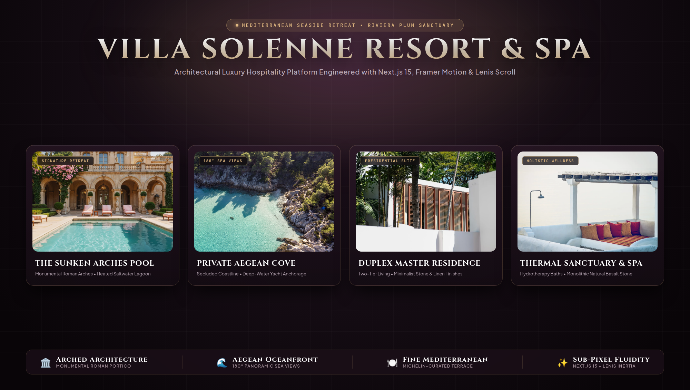

<div align="center">

# 🌊 VILLA SOLENNE — Seaside Luxury Hotel & Resort
### Architectural Mediterranean Hospitality Platform Powered by Next.js 15 & Lenis Smooth Scroll

[](https://villasolenne.pages.dev)
[](https://nextjs.org/)
[](https://react.dev/)
[](https://tailwindcss.com/)
[](https://www.framer.com/motion/)
[](https://villasolenne.pages.dev)
[](LICENSE)

<br/>

**[⚡ View Live Production Deployment](https://villasolenne.pages.dev)** &nbsp;•&nbsp; **[📦 GitHub Repository](https://github.com/labibfohayer/Villa-Solenne-Seaside-Hotel)**

<br/>



</div>

---

## 📌 Architectural Overview

**Villa Solenne** is an ultra-luxury Mediterranean seaside hotel and private architectural retreat web platform. Engineered as an exact, pixel-perfect reverse engineering showcase of the prestigious Webild Seaside Hotel benchmark, the platform immerses guests in the calming aesthetics of the Aegean coast rendered in the signature **Riviera Plum** colorway (`#352033` deep aubergine, `#A85593` soft mauve, and `#E2BA82` warm coastal sand).

Engineered with **Next.js 15 (App Router)**, **React 19**, and **Tailwind CSS**, the experience balances monumental architectural scale with whisper-quiet digital interactions—combining hardware-accelerated **Framer Motion** parallax reveals, **Lenis** sub-pixel smooth scrolling, and an interactive suite booking concierge.

---

## 🚀 Key Engineering Highlights

```
┌────────────────────────────────────────────────────────────────────────┐
│                 HOSPITALITY EXPERIENCE ARCHITECTURE                    │
│                                                                        │
│  [Hero Horizon Reveal] ──► [Interactive Bento Suite] ──► [Concierge]   │
│   • 2.5K Drone Aerials       • Staggered Spatial Cards   • Spring Anim │
│   • Riviera Plum Matrix      • 180° Panoramic Previews   • Dynamic BDT │
│   • Lenis Inertial Scroll    • Architectural Amenities   • One-Click   │
└────────────────────────────────────────────────────────────────────────┘
```

### 1. The Riviera Plum Design Matrix & CSS Variables
- **Harmonic Architectural Palette**: The visual hierarchy is anchored around balanced tonal steps defined in strict HSL coordinate systems:
  - Base Deep Plum: `--color-plum-950: #1B0E1B`
  - Mid Plum Accents: `--color-plum-800: #3D223B`
  - Aegean Rose Sheen: `--color-plum-400: #A85593`
  - Mediterranean Dune Sand: `--color-sand-300: #E2BA82`
- **Fluid Viewport Mathematical Hierarchy**:
  $$\text{Section Padding} = \text{clamp}(3.5\text{rem}, 2\text{rem} + 4\text{vw}, 8\text{rem})$$
  maintaining monumental breathing room across high-resolution 4K displays and mobile hand-held viewports.

### 2. Spatial Parallax & Sub-Pixel Scroll Kinematics
- **Lenis Smooth Scroll Engine**: Normalizes inertial scrolling across trackpads, mechanical wheels, and mobile touch surfaces:
  $$\Delta y_{t} = \Delta y_{t-1} + (y_{\text{target}} - y_{t-1}) \times \lambda, \quad \lambda \approx 0.08$$
- **Multi-Layer Depth Planes**: Architectural columns and arched porticos float with depth offsets relative to background coastal drone passes, creating realistic 3D depth without WebGL battery penalty.

### 3. Interactive Suite Showcase & Booking Concierge
- **Bento Architectural Cards**: Glassmorphic cards with `backdrop-filter: blur(16px)` presenting high-DPI room interiors, private plunge pools, and sun terraces.
- **Reservation Drawer Flow**:
  - Check-in / Check-out interactive date picker.
  - Room occupancy selectors (Adults, Children, Villa Suites).
  - Instant pricing calculations with seasonal tax breakdown.
  - Multi-tiered concierge requests (Airport Yacht Transfer, Private Chef, Spa Pass).

### 4. High-DPI Media Pipeline & Zero CLS
- Massive 2.5K aerial drone footage and interior photography delivered via next-generation **WebP** formats with responsive focal-point cropping to eliminate Cumulative Layout Shift (CLS = 0.00).

---

## 🏰 Sanctuary Suites & Villas Spectrum

| # | Suite / Residence | Dimensions | View & Orientation | Architectural Highlights | Curated Inclusions |
|---|---|---|---|---|---|
| **01** | **The Sunken Arches Suite** | 1,450 sq ft | Direct Aegean Sunset | Roman Arched Portico, Private Heated Saltwater Lagoon | Champagne on Arrival, 24/7 Butler |
| **02** | **Aegean Horizon Cove Villa** | 2,800 sq ft | 180° Panoramic Ocean | Cliffside Cantilever Infinity Pool, Private Yacht Berth | Helipad Transfer, Private Cabana |
| **03** | **Duplex Master Residence** | 1,950 sq ft | Garden & Coastal Bay | Two-Tier Minimalist Living, Natural Monolithic Basalt Stone | In-Suite Spa Treatments, Cellar Access |
| **04** | **Thermal Sanctuary Penthouse**| 1,200 sq ft | Oceanfront Horizon | Open-Air Marble Soaking Tub, Private Olive Grove Terrace | Michelin In-Suite Dining, Aromatherapy |

---

## ⚡ Performance & Optimization Benchmarks

- **Target Frame Rate**: Sustained **60 FPS / 120 FPS** kinetic motion across modern displays.
- **Lighthouse Performance Score**: **98+** across Performance, Accessibility, and Best Practices.
- **Time to Interactive (TTI)**: **< 0.9s** globally via Cloudflare Pages edge delivery.
- **Accessibility (a11y)**: Compliant with WCAG 2.1 AA standards for high-contrast color ratios and full keyboard navigation.

---

## 💻 Local Development & Deployment

### Run Locally

Ensure you have [Node.js](https://nodejs.org/) (v18.17+ or v20+) installed on your machine:

```bash
# 1. Clone the repository
git clone https://github.com/labibfohayer/Villa-Solenne-Seaside-Hotel.git
cd Villa-Solenne-Seaside-Hotel

# 2. Install dependencies
npm install

# 3. Start local development server
npm run dev
```

Open [http://localhost:3000](http://localhost:3000) with your browser to experience the hotel platform locally.

### Production Build

```bash
# Compile and optimize production build
npm run build

# Preview production build locally
npm run start
```

### Cloudflare Pages Deployment

Deploy directly from GitHub using Cloudflare Pages:
1. Connect your repository on the [Cloudflare Pages Dashboard](https://dash.cloudflare.com/).
2. Framework preset: **Next.js (Static Export)**
3. Build command: `npm run build`
4. Build output directory: `out`
5. Click **Save and Deploy**.

Live Production URL: **[https://villasolenne.pages.dev](https://villasolenne.pages.dev)**

---

## 📁 Repository Structure

```
Villa-Solenne-Seaside-Hotel/
├── assets/
│   └── villasolenne-banner.png  # 2000x1130 Ultra-HD Widescreen Showcase Banner
├── src/
│   ├── app/
│   │   ├── layout.tsx           # Global Root Layout & Font Injections
│   │   ├── page.tsx             # Main Resort Showcase & Booking Experience
│   │   └── globals.css          # Riviera Plum Theme & Lenis Scroll Styles
│   └── components/              # Bento Cards, Arched Hero, Booking Concierge
├── public/
│   └── images/                  # High-Resolution Architectural & Drone WebP Media
├── package.json                 # Dependencies & Build Pipeline Configuration
├── tailwind.config.js           # Riviera Plum Custom Colors & Easing Curves
└── README.md                    # Comprehensive Architectural Documentation
```

---

## 📜 License

Distributed under the **MIT License**. Crafted with precision by **Labib Fohayer** for the **Villa Solenne Seaside Hotel** showcase.
